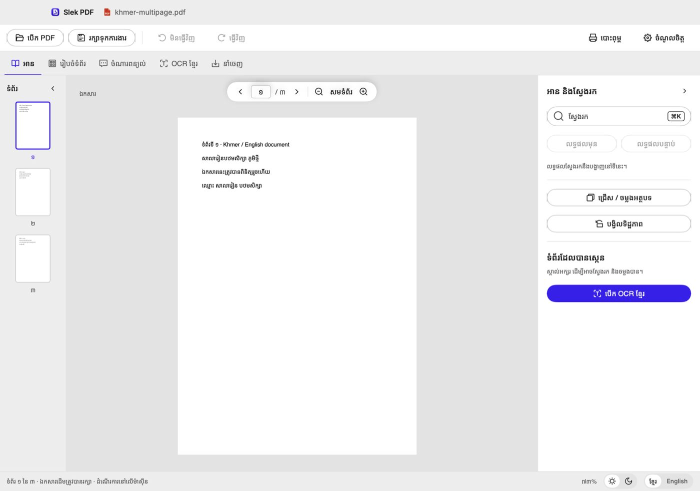
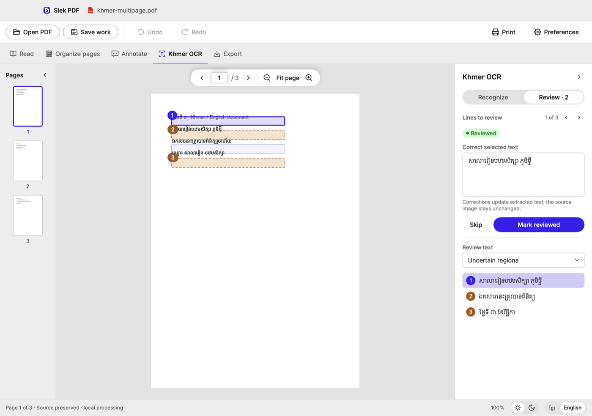
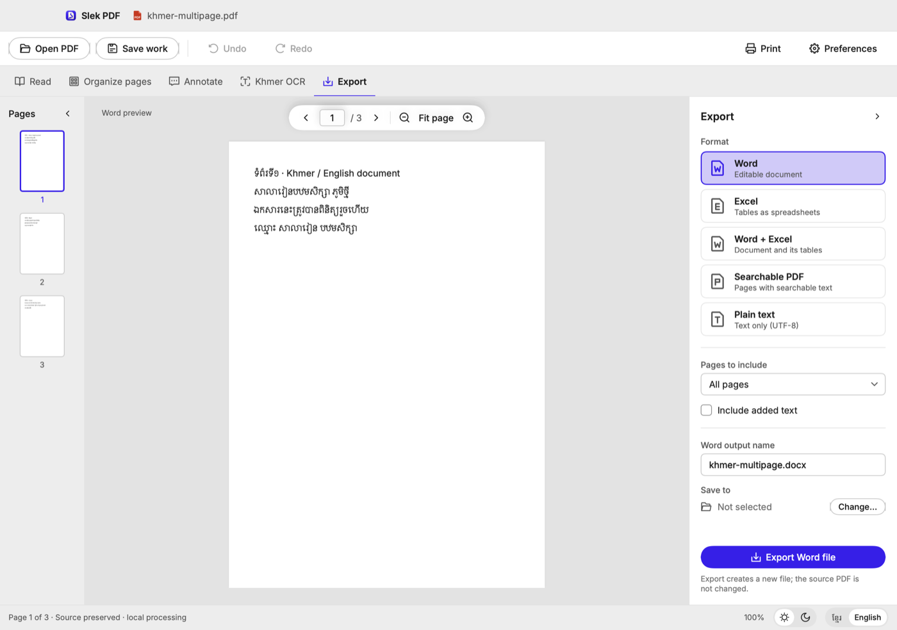
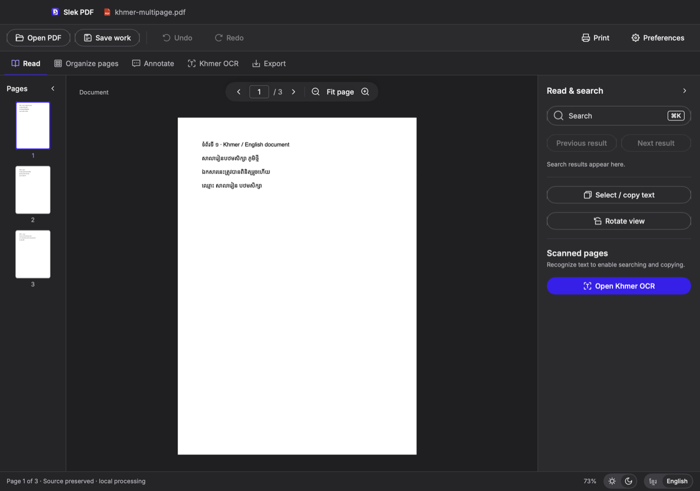

<div align="center">

# Slek PDF

**A Khmer-first PDF app for macOS.**
Read, organize, annotate and edit PDFs, recognize Khmer text, and export to Word, Excel, searchable PDF or plain text —
all on your Mac.




</div>

## Why Slek PDF

Most PDF apps get Khmer wrong: copied text comes out scrambled, search misses words, scans can't be read, and
editing breaks the letters. Slek PDF is built around Khmer from the start — and nothing ever leaves your Mac.

## Features

| Workspace | What you can do |
| --- | --- |
| **Read** | Fast page view, search that understands Khmer, copy text that pastes correctly anywhere, rotate the view |
| **Organize pages** | Reorder by dragging, rotate, delete, insert pages from another PDF, split and merge PDFs |
| **Annotate** | Click a line of the PDF's own text to change it in place · add Khmer text boxes · highlight · comment |
| **Khmer OCR** | Recognize scanned pages in Khmer and English, then check the uncertain lines marked on the page |
| **Export** | Word (`.docx`), Excel (`.xlsx`) with detected tables, Word + Excel, searchable PDF, plain text (UTF-8) |

And around them:

- **Khmer and English interface** — switch at any time; light and dark appearance.
- **Your original is never changed** — *Save work* keeps your edits editable in a separate file; every export is a new file.
- **Print**, keyboard shortcuts you can change, and recovery of unsaved work after a crash.

## Khmer OCR



Recognition runs entirely on your Mac:

- **KhmerOCR** (detector + Khmer recognizer, ONNX) and **Tesseract** (Khmer + English) work together — each line is read
  by the engine that does it best.
- Text printed **over pictures** (a title on an emblem) and **curved text around round seals** are read too.
- Copy and export use **standard Khmer Unicode order**, so text pastes cleanly into other apps.
- Old PDFs in legacy fonts (Limon, ABC) or with broken text layers are detected and recognized instead of copied as gibberish.

On our 15-document test set (Khmer, English and bilingual; digital, scanned and photographed; tables) the error rate is
**7.9 % of characters** on average, and under 3 % on clean pages. Details and per-document results:
[docs/spikes/04-khmerocr.md](docs/spikes/04-khmerocr.md).

## Export



Choose a format, see the result on the page before you export, check the review issues (pages without text,
unreviewed OCR lines), and export. Tables found on the pages become real tables in Word and sheets in Excel.

## Privacy

Slek PDF works offline. Documents, recognized text and edits stay on your Mac — nothing is uploaded, and there is no
account and no tracking. The app is sandboxed and only opens the files you choose.

## Getting started

Requirements: macOS 13 or later to run; Xcode 27.1 or later to build. Everything else is in the repository.

```bash
git clone https://github.com/cat-with-code/slekPDF.git
cd slekPDF
open SlekPDF.xcodeproj   # then press ⌘R
```

Or from the command line:

```bash
xcodebuild build -scheme SlekPDF -destination 'platform=macOS'   # build
xcodebuild test  -scheme SlekPDF -destination 'platform=macOS'   # run the tests
```

> **Note:** KhmerOCR needs Apple Silicon (ONNX Runtime ships for arm64 only). On Intel Macs, Khmer OCR uses Tesseract alone.

## For developers

The design lives in Figma and is the source of truth: colours, type, spacing, icons and every interface string
(Khmer and English) are exported from it and turned into Swift by the scripts in `Tools/`.

- **[docs/DEVELOPMENT.md](docs/DEVELOPMENT.md)** — commands, Figma → code pipeline, design-system rules, project layout, branches
- **[docs/plans/](docs/plans)** — how Annotate and Khmer OCR are built, step by step
- **[docs/spikes/](docs/spikes)** — the measurements behind key decisions (PDFKit and Khmer, Tesseract, Office export, KhmerOCR)
- **[docs/PROTOTYPE-MAP.md](docs/PROTOTYPE-MAP.md)** — which screen implements which Figma frame

<details>
<summary><b>Dark appearance</b></summary>
<br>

</details>

## Status

Slek PDF is in active development and not yet released. Known gaps:

- Exported files don't yet include text you changed with **Edit PDF text** (printing and saved work do).
- Copy and search still find a line's original text after you edit it.
- New Khmer interface strings are drafts awaiting a native-speaker review.
- Release setup: the bundle identifier is a placeholder and builds are signed ad hoc; not yet tested on a macOS 13 machine.

## Acknowledgements

Slek PDF stands on these open-source projects. Licence texts of the bundled libraries and fonts are in
[`SlekPDF/Resources/Licenses`](SlekPDF/Resources/Licenses) and shown in the app under *About ▸ Licenses*.

| Project | Used for | Licence |
| --- | --- | --- |
| [PDFium](https://pdfium.googlesource.com/pdfium/) (prebuilt by [pdfium-binaries](https://github.com/bblanchon/pdfium-binaries)) | Khmer text, search, writing PDFs | BSD-3-Clause; binaries MIT |
| [Tesseract](https://github.com/tesseract-ocr/tesseract) + [Leptonica](http://www.leptonica.org/) | OCR (Khmer, English) | Apache 2.0 / BSD-2-Clause |
| [KhmerOCR](https://github.com/seanghay/KhmerOCR) | Khmer text detection and recognition | MIT |
| [ONNX Runtime](https://github.com/microsoft/onnxruntime) | Running the KhmerOCR models | MIT |
| [khmernormalizer](https://github.com/seanghay/khmernormalizer) (SIL khnormal) | Standard Khmer Unicode order | MIT |
| [Noto Sans Khmer](https://fonts.google.com/noto/specimen/Noto+Sans+Khmer), [Inter](https://rsms.me/inter/) | Interface and Khmer text | SIL OFL 1.1 |
| [IconPark](https://github.com/bytedance/IconPark) | Interface icons | Apache 2.0 |

## License

Slek PDF is released under the [Apache License 2.0](LICENSE).
